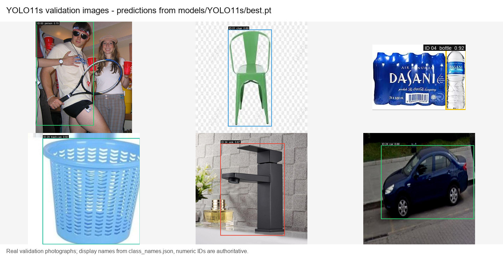
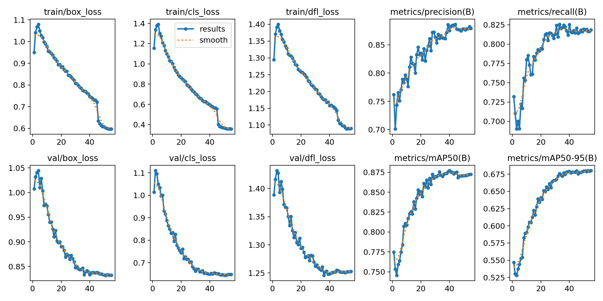
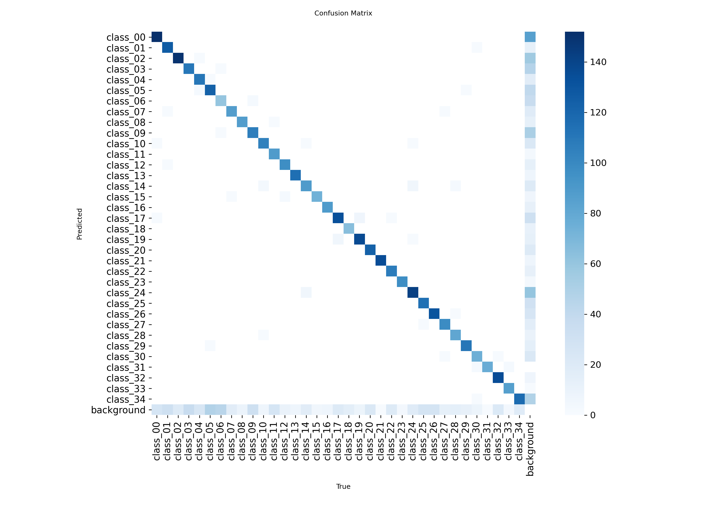
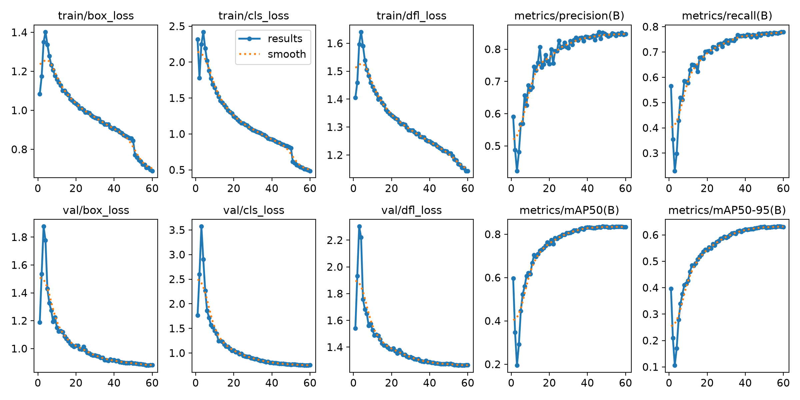
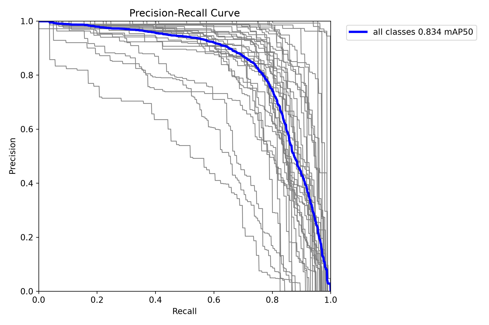
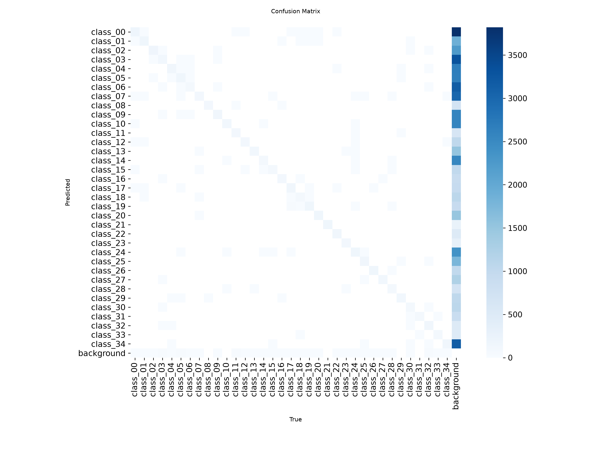

# Abstract {.unnumbered}

This project builds and evaluates a real-time object detector that recognises 35 categories of
objects in a camera image, as the perception layer of an assistive navigation aid. The starting
point was an annotated dataset of 16,122 images in four batches, with no class-name metadata at all,
so the work began from numeric IDs (0–34). All 35 names were later recovered from three independent
sources of evidence — words in the source file names, a COCO-pretrained detector and three ImageNet
classifiers — and are used throughout this report next to the IDs.

A read-only audit found label noise, 727 groups of byte-identical images, and 222 duplicate groups
that already spanned the train, validation and test splits. A cleaned, writable copy was then built
without modifying a single source file: 823 redundant images were removed and cross-split duplicate
groups were collapsed, leaving 15,303 images and 21,944 boxes.

A YOLO11s detector, pre-trained on COCO, was fine-tuned on this cleaned dataset at 640 × 640 for 60
epochs, of which 55 used cosine learning-rate decay, on an RTX 3050 Laptop 4 GB GPU. The best
checkpoint, `models/YOLO11s/best.pt`, reached precision 0.8786, recall 0.8178, mAP@50 0.8719 and
mAP@50-95 0.6800 on the 2,982-image validation split, with all 35 classes evaluated. It is the main
model of this report and was used directly in the final DroidCam voice prototype, so no retraining
was needed for deployment. Its training run is documented with loss and metric curves, a validation
confusion matrix and a sheet of real validation photographs with predicted boxes. YOLO11n and
YOLO11m are retained as baselines on the same cleaned data. The complete YOLO11n baseline scorecard
is precision 0.843, recall 0.794, mAP@50 0.847 and mAP@50-95 0.647 on the untouched test split, and
its checkpoint was exported to a verified 10.2 MB ONNX graph; the one-epoch YOLO11m checkpoint reached
validation mAP@50-95 0.317. Held-out test metrics for the YOLO11s and YOLO11m checkpoints were not
supplied and remain **PENDING**, so no test-split winner is claimed. Three tools were built on top of
the model:
a batch image predictor that writes annotated images and a CSV of boxes, a class inspection tool that
crops real examples of any class ID, and a live webcam demo. Names appear in the tables, figures and
model output, while the numeric IDs remain the authoritative labels.

# Contents {.unnumbered}

1.  Introduction
2.  Literature Review
    - 2.8 Recent research (2024–2026)
3.  Dataset Description (shared by all runs)
4.  Methodology
5.  Model Architecture
    - 5.1 YOLO11s as the primary architecture
    - 5.5 YOLO11n and YOLO11m reference points
6.  Model Training
    - 6.1 YOLO11s training run
    - 6.5 Baseline runs: YOLO11n and YOLO11m
7.  Performance Evaluation
    - 7.2 Overall YOLO11s results
    - 7.3 YOLO11s confusion and qualitative results
    - 7.5 Model-scale validation and test comparison
    - 7.6 Full YOLO11n performance metrics
    - 7.7 Baseline YOLO11n result figures
8.  Model Optimisation
9.  Application Development
10. Results and Discussion
    - 10.7 YOLO11s results in context
    - 10.8 Result figures, workflow diagrams and launchers
11. Limitations
12. Conclusion and Future Scope
13. References

Appendix A — Full per-class test results

```{=openxml}
<w:p><w:r><w:br w:type="page"/></w:r></w:p>
```

# 1. Introduction

## 1.1 Project overview

A person who cannot see clearly still has to walk through a world full of things that can be walked
into. A doorway, a chair leg, a low table, a kerb and a waste bin are ordinary objects, but for
someone with low vision each one is a possible fall. The long-term goal of assistive navigation
research is a small device — a phone, a chest-mounted camera or a pair of smart glasses — that looks
ahead and warns of what is in front.

The first requirement of such a device is perception: taking a camera frame and producing a list of
objects, each with a rectangular boundary and a category. This project builds that layer end to end —
from the shared cleaned dataset, through a YOLO11s training run, to measured performance and an
audible DroidCam prototype. YOLO11s is the primary model because it offers a practical balance between
accuracy and laptop inference cost; YOLO11n and YOLO11m are kept as baseline reference points.

The work spends as much effort on data honesty as on modelling. A detection score is only meaningful
if the test images were never seen during training, and early inspection showed that this was not
guaranteed. Removing that contamination in a copy of the data was a large part of the project, and the
same derived split is used by the YOLO11s run and by both baselines.

## 1.2 Objectives

- To audit the supplied 35-class dataset without altering any original file, and to quantify its
  label quality, duplication and split leakage.
- To construct one clean, reproducible training copy in which duplicated images cannot leak between
  train, validation and test; this shared dataset description is not repeated for each model.
- To fine-tune YOLO11s at 640 × 640 as the main experiment and preserve its best checkpoint for
  deployment.
- To document the YOLO11s training run with loss and metric curves, validation precision–recall
  behaviour, a confusion matrix and real validation photographs with predicted boxes.
- To retain YOLO11n and YOLO11m as baselines on the same cleaned split, reporting their completed
  validation results and keeping unsupplied test metrics **PENDING**.
- To recover a display name for every class ID from independent evidence, so the results can be read
  without a lookup table.
- To build usable interfaces for still images, video files and a DroidCam live feed with offline
  spoken guidance.

## 1.3 Problem statement

Given an RGB camera image, the system must output bounding boxes, each labelled with one of 35
classes and a confidence score, fast enough for consumer hardware. The dataset shipped with numeric
labels only, so the system must work with IDs and treat names as display metadata that can be
changed without retraining. The reported accuracy must reflect performance on images the model has
genuinely never seen.

## 1.4 Scope

The main experimental scope is the YOLO11s detection run and its use in a research prototype. The
shared dataset preparation is described once in Chapters 3 and 4; Chapters 5 to 7 and 10 then follow
the YOLO11s checkpoint. YOLO11n is the low-power baseline and YOLO11m the larger reference model,
trained by teammates on the same cleaned split but with their own documented schedules. Calibrated
depth, path planning and a user trial are outside the scope; the “20 metres ahead” phrase in the
final launcher is an explicit demonstration override, not a sensor measurement.

# 2. Literature Review

## 2.1 The object detection problem

Object detection combines two tasks that are easy for humans and hard for machines: deciding *what*
is in an image and deciding *where* it is. A detector must produce boxes, label each one, and do so
without being told how many objects are present. Before deep learning this was done with hand-
designed features such as HOG or SIFT combined with sliding windows. Those pipelines were slow and
fragile under changes in lighting, scale and viewpoint.

## 2.2 Convolutional neural networks

LeCun et al. (1998) showed that learned convolution filters could recognise handwritten digits with
very low error, using weight sharing so that a useful pattern is useful anywhere in the image. The
idea stayed modest until Krizhevsky et al. (2012) trained AlexNet on ImageNet and beat classical
methods by a large margin, thanks to GPU computing and enough labelled data.

Depth brought its own problem: gradients fade as they travel backwards through very deep networks.
He et al. (2016) solved this with residual connections, in which a layer learns a *change* to its
input rather than a complete transformation; residual blocks now appear inside almost every detector
backbone.

## 2.3 Two-stage detectors

The first deep detectors separated finding from classifying. Girshick et al. (2014) proposed R-CNN:
generate about two thousand region proposals, run a CNN on each, and classify the result. It was
accurate but extremely slow, because the CNN ran separately on every proposal. Fast R-CNN (Girshick,
2015) shared the convolution work across proposals, and Faster R-CNN (Ren et al., 2015) replaced the
classical proposal algorithm with a learned Region Proposal Network.

## 2.4 One-stage detectors and YOLO

Redmon et al. (2016) took the opposite approach. YOLO — *You Only Look Once* — divided the image into
a grid and asked each cell to predict boxes and class probabilities in a single forward pass, with no
proposal stage. It was less accurate on small objects than Faster R-CNN but dramatically faster, and
it set the design almost all real-time detectors follow today.

Feature pyramids (Lin et al., 2017a) later combined deep semantic features with shallow
high-resolution ones so that small objects stay detectable, and the focal loss (Lin et al., 2017b)
down-weighted the many easy background locations that would otherwise dominate training. FCOS (Tian
et al., 2019) showed that anchor boxes could be removed entirely.

## 2.5 Evolution of the YOLO family

YOLOv3 (Redmon & Farhadi, 2018) introduced multi-scale predictions and a stronger backbone and became
the default choice in practical work for years. YOLOv4 (Bochkovskiy et al., 2020) added mosaic
augmentation, CIoU loss and other training improvements. From YOLOv5 onwards the Ultralytics
implementation made the family easy to train and export, a large part of why YOLO is now the default
in applied projects.

YOLO11 (Jocher et al., 2024) keeps the anchor-free, decoupled-head design of YOLOv8, changes the
backbone and neck blocks to C3k2 modules, adds a spatial pyramid pooling stage at the end of the
backbone, and uses a distribution focal loss (Li et al., 2020) for box regression, predicting a
probability distribution over box edges instead of a single offset. The family scales from roughly
two million parameters (nano) to tens of millions, all trained with the same recipe.

## 2.6 Transfer learning and evaluation

Training a detector from random weights needs far more data and time than a student project can
provide. Transfer learning reuses features learned on a large general dataset such as COCO (Lin et
al., 2014), which already knows edges, textures and object-like shapes, and adapts only the final
layers. This is why a nano model can reach a respectable score after under two hours of training.

Detections are matched to ground truth using the Intersection over Union (IoU). *Precision* is the
fraction of reported boxes that were correct; *recall* is the fraction of real objects that were
found. Average precision (AP) summarises the precision–recall curve for one class, and mean average
precision averages it over classes. mAP@50 uses a lenient 0.50 IoU threshold; mAP@50-95 averages
thresholds from 0.50 to 0.95 and rewards tightly fitted boxes. This project reports both and treats
mAP@50-95 as the honest headline number.

## 2.7 The gap this project addresses

Published results are measured on COCO or Pascal VOC, where names, splits and annotation quality are
controlled. Applied datasets often arrive with numeric labels, no metadata, duplicated images and
inconsistent annotations, and a model trained on them can look far better than it is. This project
therefore treats data auditing as part of the method and reports results only after measurable
leakage has been removed.

## 2.8 Recent research (2024–2026)

Recent work makes two points that directly shape this project. First, the YOLO family is still
evolving quickly rather than being a settled 2020-era tool. Xu et al. (2024) survey the YOLO series,
while Tian et al. (2026) trace its development from early one-stage detectors to recent releases;
Jiao and Abdullah (2024) review its use in unmanned aerial vehicles. Ultralytics released YOLO11 in
September 2024 and, in its official documentation, reports five detection scales — nano, small,
medium, large and extra-large — with COCO mAP@50-95 rising from 39.5 for YOLO11n to 47.0 for YOLO11s
and 51.5 for YOLO11m, at a large increase in parameters and FLOPs (Jocher & Qiu, 2024). Recent applied
studies confirm that YOLO11 is being adopted quickly: Gong et al. (2025) build a small-object variant
for UAV imagery, Zhou et al. (2025) improve occlusion robustness, and Dang et al. (2025) and Wang and
Liu (2025) adapt YOLO11 to underwater detection. El Dhimni et al. (2026) explicitly compare YOLO11s
with an earlier YOLOv8s, which supports the value of scale-wise comparison rather than reporting a
single model in isolation.

Second, assistive navigation remains an active application area rather than a solved problem. Ben
Atitallah et al. (2024) propose a deep obstacle-detection system for blind and visually impaired
navigation, Singh et al. (2024) combine object detection with depth prediction, and Pongiannan et al.
(2024) add voice feedback. Thakur and Pandey (2025) return to the same navigation problem with
object detection, and Dang et al. (2024) apply detection to kitchen independence. These studies share
the assumption that perception must be accurate and usable in real time, but they also usually rely
on clean, named datasets. The present project contributes a different practical lesson: before any
model scale is compared, the dataset must be audited for duplicated images and cross-split leakage.
That is why the model-scale comparison in Sections 6.5 and 7.5 uses the cleaned split rather than the
raw four-batch collection.

For this report, “recent research” means sources published in 2024 or later. Older papers are retained
only in the foundational part of the reference list where they explain ideas that the recent work
builds on; the evidence base for the current state of the field is the 2024–2026 list.

# 3. Dataset Description

This chapter is common to every model in the study. The YOLO11s run, the YOLO11n baseline and the
YOLO11m reference checkpoint all consume the same cleaned `data.yaml` described in Chapter 4, so the
dataset is not re-described for each model below.

## 3.1 Source and structure

The dataset was supplied as a folder named `final batches` containing four batches, each with
`images/train`, `images/val`, `images/test` and matching `labels` folders. Labels are plain text in
the standard YOLO format, one line per object:

```
class_id  x_center  y_center  width  height
```

All four coordinates are normalised to 0–1, and `class_id` is an integer from 0 to 34 with no gaps.
File names follow the pattern `name_jpg.rf.938329010f8ef2aa4a8d87f3636f3f0b.jpg`, which is the
naming convention of a Roboflow export and is the strongest available clue about the dataset's
origin.

Table 1 summarises the source: 16,122 image files, 16,107 label files and 23,043 bounding boxes. The
difference of 15 is not missing data — fifteen image pairs share one file name stem within the same
split, so only one label can exist for the pair.

| Batch | Images | Labels | Boxes | Dominant formats |
|:------|-------:|-------:|------:|:-----------------|
| Batch 1 | 3,959 | 3,959 | 6,020 | jpg, jpeg, png |
| Batch 2 | 4,100 | 4,100 | 5,848 | jpg, jpeg, png |
| Batch 3 | 4,066 | 4,062 | 5,846 | jpg, jpeg, png, webp, gif |
| Batch 4 | 3,997 | 3,986 | 5,329 | jpg, jpeg, png |
| **Total** | **16,122** | **16,107** | **23,043** | |

Table 1. Source dataset composition, measured by a read-only audit.

## 3.2 Classes and balance

Each of the 35 classes appears in every batch and every split. Box counts range from 525 (class 30)
to 943 (class 0), a ratio of only 1.80 : 1. Real datasets are usually strongly long-tailed, so a
ratio this flat suggests deliberate balancing or curated sources. That is not an error, but it means
the measured mAP will not reflect behaviour on a naturally imbalanced stream of images.

{width=6.3in}

## 3.3 Class names recovered from evidence

A recursive search of the dataset and its neighbouring folders found no `data.yaml`, no `classes.txt`,
no `obj.names`, no README and no JSON or CSV metadata, so the annotation files contain integers only
and the training configuration uses placeholder names `class_00` to `class_34`. The names used in this
report were recovered after training from three independent sources: distinctive words in the source
image file names (`manhole_cover`, `walking stick`, `gents`), the label a COCO-pretrained YOLO11n gave
the annotated box, and the top class from three ImageNet classifiers on tight crops. Unanimous
evidence was accepted directly; the four IDs where the sources disagreed are discussed in §10.5.

{width=4.4in}

Names are display metadata only. The label files, the trained weights and the ONNX graph still speak
in IDs 0–34, and `class_names.json` is the single place where the mapping lives, so any name can be
corrected without retraining.

## 3.4 Image properties and domain

Images range from 76 to 8,660 pixels on the longest side and are stored as JPEG, PNG and, in a few
cases, WebP or GIF — typical of a dataset assembled from web sources rather than one camera. As a
weak, non-authoritative hint about the domain, file names contain words such as *bed*, *bus*, *oven*,
*manhole*, *waste*, *barrier*, *chair* and *stair*, suggesting a heterogeneous collection of indoor
and street objects. A file name does not by itself prove which class ID an object carries, which is
why it was only one of the three evidence sources used in §3.3.

## 3.5 Data quality problems found

The annotation format itself was clean: zero malformed lines, zero out-of-range coordinates, zero
boxes outside the frame, zero empty label files and zero images without a label. The problems were
elsewhere.

| Problem | Count | Why it matters |
|:--|--:|:--|
| Groups of byte-identical images | 727 (1,545 files) | Same picture counted more than once |
| Duplicate groups spanning splits | 222 | Test images already seen in training |
| Source-image groups from augmented copies | 639 (1,431 files) | Crops and resizes leak as well |
| Duplicate groups with conflicting labels | 554 | Same image, different annotation |
| Identical images with a different class ID | 7 | Direct label contradiction |
| Identical images with different box geometry | 177 | Direct label contradiction |
| Image pairs sharing one label stem | 15 | One image in each pair is untrainable |
| Images in a format the trainer cannot read | 1 (.gif) | Would abort or be skipped |

Table 2. Data quality findings from the source audit.

The 222 cross-split duplicate groups are the most important entry: if the same photograph appears in
training and in the test set, the model can score well by remembering it, and the reported accuracy
becomes meaningless.

{width=5.9in}

This comparison is the clearest of the seven class conflicts. Nothing in the image changed between the
two exports — only the numbers did — which is why the pipeline could not repair it automatically.

# 4. Methodology

## 4.1 Pipeline overview

The work followed five stages, each producing an auditable artefact: read-only verification of the
source; staging as a byte-for-byte copy with four format conversions; construction of a writable
derived training copy with duplicates removed; a visual audit of every class; and finally training,
evaluation and export. The rule throughout was that the original dataset is evidence and must not
change. A copy was used for training, and every change to that copy was logged.

## 4.2 Staging and format conversion

Staging copied all 16,122 images and 16,107 labels, preserving the batch and split structure. Three
files with a `.webp` extension actually contained JPEG data and one was a genuine GIF; all four were
decoded and re-encoded losslessly as PNG, giving 16,126 images, with the originals kept — the training
framework cannot read a GIF at all.

Verification confirmed 16,126 decodable images, unchanged label bytes, class IDs and coordinates, and
zero overwrites. Hashing 32,233 files before and after the whole preparation showed that the source
never changed.

## 4.3 Duplicate detection and leakage removal

Duplicates were detected on **decoded pixels**, not file bytes. The same photograph saved as JPEG and
as PNG, or twice at different JPEG quality, has different bytes but identical pixels, so a byte-level
hash would miss those pairs. Decoding every image and hashing the pixel array found 730 duplicate
groups.

Each group was assigned to exactly one split using the priority **test > val > train**. The reasoning
is asymmetric: losing a test image weakens the measurement, while losing a training image costs
almost nothing. In total 823 redundant images were removed — 815 byte-identical and 8 re-encoded
copies. Of the 730 groups, 222 had members in more than one original split; those were the actual
leaks, and afterwards no group spans two splits.

Two gaps remain. Near-duplicates that are not pixel-identical — a crop, a resize, a watermark —
cannot be caught this way. And where duplicate images carried conflicting annotations, the pipeline
kept one representative label rather than deciding which was correct.

## 4.4 Split construction and configuration

The cleaned copy contains 15,303 images and 21,944 boxes, split as shown in Table 3. The test split
was left as supplied apart from duplicate removal, so the final score is measured on the dataset
owner's own held-out data.

| Split | Images | Boxes | Average boxes per image |
|:------|-------:|------:|------------------------:|
| Train | 11,526 | 16,316 | 1.42 |
| Validation | 2,982 | 4,408 | 1.48 |
| Test | 795 | 1,220 | 1.53 |
| **Total** | **15,303** | **21,944** | 1.43 |

Table 3. The derived training dataset after duplicate removal. This is the exact split used by the
YOLO11s training run and by both baseline checkpoints.

The real validation photographs below are drawn from that same split. The boxes are predictions made
by the final `models/YOLO11s/best.pt` checkpoint, not ground-truth annotations, so the sheet shows
what the deployed model actually sees.

{width=6.3in}

*Figure 3a. YOLO11s predictions on validation images from the cleaned dataset, generated by
`report/make_yolo11s_report_figures.py`.*

A `data.yaml` was written with `nc: 35` and the placeholder names, plus a `data_original.yaml`
pointing at the original layout so the effect of cleaning could be compared later.

## 4.5 Augmentation

YOLO's default recipe was used with two deliberate changes: geometric transforms that distort an
object's real proportions (rotation, shear, perspective) were left at zero, and mixup was disabled.
Mosaic — pasting four training images into one canvas — was kept at full strength, because it is the
most effective augmentation for small-object detection. It was switched off for the last ten epochs,
a standard trick that lets the model finish on realistic photographs rather than collages.

| Setting | Value | Effect |
|:--|:--|:--|
| HSV hue / saturation / value | 0.015 / 0.7 / 0.4 | Colour and lighting robustness |
| Translation | 0.10 | Position robustness |
| Scale | 0.50 | Object-size robustness |
| Horizontal flip | 0.50 | Free extra data |
| Mosaic | 1.00 | Four images combined per sample |
| Random erasing | 0.40 | Occlusion robustness |
| Rotation, shear, perspective | 0.0 | Avoids unrealistic distortion |
| Mixup, cutmix | 0.0 | Not needed at this data size |

Table 4. Augmentation settings used during training.

## 4.6 Visual audit of the classes

Because the dataset arrived without class names, a visual audit was performed before training. For
each class, up to 20
unique examples were cropped from their label boxes and pasted into one contact sheet with the crop
outlined in green. Sampling was stratified by object size — seven small, seven medium and six large
boxes per class — with a fixed seed of 20261109, and only boxes of the target class were drawn. The
result was 35 sheets covering 700 unique images, giving a human-checkable view of what each numeric ID
looks like.

## 4.7 Training and evaluation protocol

Training used only the train split; the validation split drove checkpoint selection and early
stopping; the test split was used exactly once, at the end, on the best validation checkpoint. That
separation is what makes the test score in Chapter 7 credible. Everything ran in one conda
environment with pinned package versions, a fixed seed and deterministic algorithms, so the run can
be repeated.

# 5. Model Architecture

## 5.1 YOLO11s as the primary architecture

YOLO11 is published in five detection sizes. This project selects **small (YOLO11s)** as the primary
architecture because it offers a practical balance for a laptop-based assistive prototype: the final
checkpoint has 9,426,345 parameters and about 21.5 GFLOPs at 640 × 640, while still reaching the
highest validation accuracy of the three models tested here. **Nano (YOLO11n)** is retained as the
low-power baseline and **medium (YOLO11m)** as the larger reference point. All three share the same
anchor-free, decoupled-head design; only width, depth and channel capacity change. The dataset is
common, so the architecture chapter now describes YOLO11s first and treats the other two scales as
comparisons.

## 5.2 Overall structure

YOLO11 is a single-stage, anchor-free detector with three parts.

**Backbone.** A stack of convolutional blocks that progressively halves spatial resolution and
doubles channel count, extracting features from fine texture to whole-object shape. YOLO11 replaces
the earlier C2f block with a **C3k2** block, a cheaper split-and-merge design that keeps gradient
flow while reducing computation. The backbone ends with an **SPPF** stage, which pools features at
several kernel sizes and concatenates them, giving a cheap multi-scale view of the whole image.

**Neck.** A path-aggregation network that fuses the three backbone levels. Deep features carry
strong semantics but poor spatial precision; shallow features carry precise edges but weak semantics.
The neck upsamples deep features and adds them to shallow ones, then downsamples again, so every
output level has both.

**Head.** A decoupled detection head, with separate convolutional branches for classification and
box regression because the two tasks prefer different features. It is anchor-free: it predicts
distances from a point to the four box edges rather than offsets from predefined anchors.

| Property | Value |
|:--|:--|
| Variant | YOLO11s (small) |
| Parameters | 9,426,345 (9.43 M) |
| Compute at 640 × 640 | ≈ 21.5 GFLOPs (fused checkpoint summary) |
| Output strides | 8, 16, 32 |
| Prediction points at 640 | 80×80 + 40×40 + 20×20 = 8,400 |
| Output tensor | 1 × 39 × 8,400 (4 box values + 35 class scores) |
| Anchor boxes | None (anchor-free) |
| Box loss | CIoU + distribution focal loss |
| Class loss | Binary cross-entropy |

Table 5. Summary of the YOLO11s architecture used in the main training run.

## 5.3 Output and loss

The network produces a tensor of shape 1 × 39 × 8,400: for each of 8,400 candidate points, four
values describe the box edges and thirty-five describe class scores. There is no softmax across
classes; each score is an independent sigmoid, which allows overlapping labels and matches the
binary cross-entropy loss.

Box regression uses a **distribution focal loss** (DFL). Instead of predicting a single distance to
each edge, the model predicts a distribution over discrete distances and takes the expectation,
which gives finer, more stable localisation. A CIoU overlap term penalises boxes that are the right
size but in the wrong place. Class assignment uses task-aligned assignment, matching predictions to
ground truth by confidence and box overlap rather than a fixed IoU rule.

## 5.4 Detection at inference

At inference the raw tensor is decoded into boxes, low-confidence boxes are discarded, and
non-maximum suppression removes duplicates describing the same object. Three thresholds control this:
confidence (0.25 for batch prediction, 0.35 for the webcam demo), NMS IoU (0.45), and a maximum of
100 detections per image. All are adjustable at run time, which matters because a quiet corridor and
a busy street need different settings.

## 5.5 YOLO11n and YOLO11m reference points

All three variants share the same anchor-free, decoupled-head design, the same three output strides
and the same 35-class output layer; only the width, depth and channel capacity of the backbone and
neck change. Ultralytics' official COCO reference values illustrate the scale of the trade-off
(Jocher & Qiu, 2024).

| Variant | Parameters | FLOPs at 640 | COCO mAP@50-95 | CPU ONNX speed |
|:--|--:|--:|--:|--:|
| YOLO11n | 2.6 M | 6.5 B | 39.5 | 56.1 ± 0.8 ms |
| YOLO11s | 9.4 M | 21.6 B | 47.0 | 90.0 ± 1.2 ms |
| YOLO11m | 20.1 M | 68.1 B | 51.5 | 183.2 ± 2.0 ms |

Table 5a. Official COCO reference values for the three YOLO11 scales. These are *not* results on
this project's dataset; they only motivate the comparison.

These COCO values are background only. On this project's cleaned validation split, YOLO11s actually
leads both references, while YOLO11m is held back by its one-epoch schedule. Sections 6.5 and 7.5
report those measured baseline runs and keep the held-out test cells **PENDING** where no teammate
evaluation was supplied.

# 6. Model Training

## 6.1 YOLO11s environment and hardware

The main YOLO11s run used a laptop GPU with 4 GB of video memory; that limit is why the batch size
is 8 rather than 16. The exact documented stack is given in Table 6. The baseline environments differ
and are summarised separately in Section 6.5.

| Component | Specification |
|:--|:--|
| GPU | NVIDIA GeForce RTX 3050 Laptop GPU, 4 GB |
| Device | `cuda:0` |
| Python | 3.12.0 |
| Framework | Ultralytics 8.4.32 |
| Deep-learning library | PyTorch 2.5.1+cu121 |
| CUDA | 12.1 |

Table 6. Documented environment of the YOLO11s training run.

## 6.2 YOLO11s hyperparameters

YOLO11s started from the official COCO-pretrained `yolo11s.pt`. The detection head was re-initialised
for 35 classes while the backbone and neck began from learned features, and no layers were frozen, so
the whole network adapted to the cleaned dataset. Only values recorded in the supplied model
documentation are claimed; unsupplied settings are not guessed.

| Setting | Value | Reason |
|:--|:--|:--|
| Base weights | `yolo11s.pt` | Transfer learning from COCO |
| Epochs | 60 total, 55 with cosine decay | Full schedule with a smooth learning-rate tail |
| Batch size | 8 | Largest documented setting for 4 GB VRAM |
| Input size | 640 × 640 | Standard speed/accuracy balance |
| Learning-rate schedule | Cosine annealing enabled | Stabilises the final epochs |
| Optimizer | Auto / AdamW | Recorded in the model README |
| Close mosaic | Last 10 epochs | Finish on realistic photographs |
| Device | `cuda:0` | Single-GPU training |

Table 7. Documented YOLO11s hyperparameters.

## 6.3 The YOLO11s training run

The run completed all 60 epochs and produced `models/YOLO11s/best.pt`. Validation was computed
during training and the best checkpoint reached precision 0.8786, recall 0.8178, mAP@50 0.8719 and
mAP@50-95 0.6800 on the 2,982-image validation split. That checkpoint is the one loaded by the
DroidCam launchers; no retraining was required for the final prototype. The wall-clock training time
was not supplied and is therefore not estimated here.

{width=5.6in}

*Figure 6a. YOLO11s training curves from `models/YOLO11s/results.png`.*

## 6.4 Reading the YOLO11s curves

The curve figure is the record of the run: training losses fall and the validation metrics rise as the
35-class head adapts, with the cosine tail and the ten-epoch mosaic close shaping the final part of
training. Exact epoch-by-epoch values are not transcribed into prose because they are not supplied as
a table; the plotted figure is retained so the progression can be inspected directly. The checkpoint
selected by validation is the one used for evaluation and deployment.

## 6.5 Baseline runs: YOLO11n and YOLO11m

The two baseline checkpoints were trained on the same derived dataset and the same 640 × 640 input,
but with their own schedules. YOLO11n is the low-power run completed in this project; YOLO11m is the
teammate reference trained for one epoch on the same 4 GB class of laptop GPU as YOLO11s. The table
records the completed protocol. The remaining **PENDING** entries apply only to the held-out test
split, not to training or validation.

| Model | Trained by | Status | Epochs | Img size | Batch | Device | Checkpoint |
|:--|:--|:--|--:|--:|--:|:--|:--|
| YOLO11n | This project | Complete | 60 | 640 | 16 | RTX 4050 Laptop 6 GB | `runs/full_yolo11n_640_v3/weights/best.pt` |
| YOLO11s | Teammate | Complete | 60 (55 cosine fine-tune) | 640 | 8 | RTX 3050 Laptop 4 GB | `models/YOLO11s/best.pt` |
| YOLO11m | Teammate | Complete | 1 | 640 | 4 | RTX 3050 Laptop 4 GB | `models/YOLO11m/best.pt` |

Table 7a. Completed training protocol for the three model scales. YOLO11s also used a ten-epoch
mosaic close; YOLO11m trained in 14.1 minutes with AMP enabled.

For completeness, the YOLO11n baseline completed 60 epochs in 6,819 seconds — 1 hour 54 minutes — on
a RTX 4050 Laptop 6 GB GPU. Validation was computed every epoch and the best checkpoint was saved at
epoch 57 with validation mAP@50-95 of 0.6319; the final epoch scored 0.6304. Two earlier attempts
stopped in the first epoch because Windows data-loading workers failed while caching the dataset;
reducing the worker count to 2 and disabling RAM caching produced the completed run. The early dip in
its validation curve is the cost of re-initialising the 35-class head while the COCO-pretrained
backbone adjusts, not a failed run.

The evaluation protocol is shared: validation drives checkpoint selection, and the held-out test
split is intended to be evaluated once on each best checkpoint. Precision, recall and F1 are reported
at the chosen operating threshold, while mAP@50 and mAP@50-95 come from the standard validation
procedure so that the three models can be compared fairly (Ultralytics performance-metric guidance,
2024). Validation metrics are now available for all three models; test metrics for the teammate
checkpoints remain **PENDING** because they were not supplied.

# 7. Performance Evaluation

## 7.1 Metrics used

**IoU** measures how well two boxes agree: the shared area divided by the combined area. **Precision**
answers "of the boxes the model drew, how many were real?" and **recall** answers "of the real
objects, how many did it find?". The two trade off, because lowering the confidence threshold finds
more objects but also invents more.

**AP** is the area under the precision–recall curve for one class, summarising the whole trade-off in
one number instead of picking a threshold. **mAP@50** averages AP across classes with a lenient 0.50
IoU requirement; **mAP@50-95** averages over ten thresholds from 0.50 to 0.95, so it rewards boxes
that are tightly fitted rather than merely in the right neighbourhood.

This chapter reports the main YOLO11s result first (Sections 7.2–7.3), followed by export validation
(7.4) and the shared three-model comparison (7.5). The complete YOLO11n baseline scorecard is kept in
Sections 7.6–7.7, and its full 35-class per-class test results remain in Appendix A.

## 7.2 Overall YOLO11s results

| Split | Images | Boxes | Precision | Recall | mAP@50 | mAP@50-95 |
|:--|------:|------:|----------:|-------:|-------:|----------:|
| **Validation** | **2,982** | **4,408** | **0.8786** | **0.8178** | **0.8719** | **0.6800** |
| Test | 795 | 1,220 | **PENDING** | **PENDING** | **PENDING** | **PENDING** |

Table 8. Overall YOLO11s detection performance on the cleaned dataset. The validation row is the
documented result for `models/YOLO11s/best.pt`; the test row is left visible rather than guessed.

The deployed checkpoint finds about four out of five annotated objects and produces very few false
boxes. Precision (0.8786) is slightly above recall (0.8178), so it is conservative: a missed obstacle
is still more likely than an invented one. The 0.19 gap between mAP@50 and mAP@50-95 is the
localisation cost — the right object is usually found, but its box edges are not always tight enough
for the stricter thresholds. Because this is the validation split used for checkpoint selection, the
number is a model-selection result, not a final held-out claim.

## 7.3 YOLO11s confusion and qualitative results

{width=5.4in}

*Figure 7a. YOLO11s validation confusion matrix from
`models/YOLO11s/confusion_matrix.png`.*

The diagonal is strong for most IDs. The visible off-diagonal cells are the useful part: they show
which pairs of real objects the model still confuses, and they should be read together with the
annotation audit rather than treated as proof of a model bug. Seven pairs of byte-identical images
carry boxes with different class IDs, and 177 more disagree about box geometry, so some confusions are
inherited from the labels. The figure uses numeric IDs; the recovered names in `class_names.json` are
display metadata only and do not change what the checkpoint learned.

The six real validation photographs in Figure 3a show the same model in a more intuitive form. Boxes
are predictions from the final checkpoint, with confidences from 0.70 to 0.92, covering person, chair,
bottle, trash can, sink and car. These are qualitative examples, not a substitute for the metrics
above.

## 7.4 Export validation

The YOLO11n baseline checkpoint was exported to ONNX with a static 640 × 640 input, producing a
10,696,956-byte (10.2 MB) file at opset 12. It passed the official ONNX checker and ran under ONNX
Runtime at about 0.04 seconds per frame on CPU. The graph reports an input of 1 × 3 × 640 × 640 and
an output of 1 × 39 × 8,400, matching the shared YOLO11 output structure in Chapter 5. This export is
kept as a portability demonstration; the final DroidCam prototype uses the YOLO11s PyTorch checkpoint
directly.

## 7.5 Model-scale accuracy comparison

The table below compares all three scales on the same cleaned **validation** split (2,982 images and
4,408 boxes), using the values supplied with each checkpoint. This is the only complete three-model
comparison currently available. YOLO11s gives the strongest validation result, YOLO11n remains a
competitive low-power baseline, and YOLO11m is clearly under-trained because its checkpoint comes
from a single epoch.

| Model | Images | Boxes | Precision | Recall | mAP@50 | mAP@50-95 | Result source |
|:--|--:|--:|--:|--:|--:|--:|:--|
| YOLO11n | 2,982 | 4,408 | 0.8463 | 0.7745 | 0.8343 | 0.6323 | This project, validation split |
| YOLO11s | 2,982 | 4,408 | 0.8786 | 0.8178 | 0.8719 | 0.6800 | Teammate checkpoint, validation split |
| YOLO11m | 2,982 | 4,408 | 0.5390 | 0.4710 | 0.5000 | 0.3170 | Teammate checkpoint, validation split |

Table 7b. Validation accuracy comparison on the cleaned split. All three rows use the same images,
image size, class IDs and evaluation protocol.

The held-out test split (795 images and 1,220 boxes) was evaluated for YOLO11n only. The teammate
test values were not supplied and are left visible rather than estimated.

| Model | Images | Boxes | Precision | Recall | mAP@50 | mAP@50-95 | Result source |
|:--|--:|--:|--:|--:|--:|--:|:--|
| YOLO11n | 795 | 1,220 | 0.843 | 0.794 | 0.847 | 0.647 | This project, test split |
| YOLO11s | 795 | 1,220 | **PENDING** | **PENDING** | **PENDING** | **PENDING** | Teammate's test evaluation not supplied |
| YOLO11m | 795 | 1,220 | **PENDING** | **PENDING** | **PENDING** | **PENDING** | Teammate's test evaluation not supplied |

Table 7c. Accuracy comparison on the cleaned held-out test split. Only measured values are shown.

When the missing values arrive, the preferred decision rule is: choose the *smallest* model whose
mAP@50-95 gain over the next smaller model is large enough to justify its extra latency and memory.
A small gain on a 795-image test set may be within noise, so the per-class table and confidence
intervals should be inspected before claiming that a larger model is better. The comparison should
also report inference time on the same hardware, because the official COCO speed figures in Table 5a
will not transfer exactly to this 35-class model or to a student laptop.

## 7.6 Baseline detail: full YOLO11n performance metrics

Because YOLO11s is the deployed model, the YOLO11n numbers are kept as a complete baseline rather than
the headline. Its test score is the only completed held-out evaluation in the project.

| Split | Images | Boxes | Precision | Recall | mAP@50 | mAP@50-95 |
|:--|------:|------:|----------:|-------:|-------:|----------:|
| Validation | 2,982 | 4,408 | 0.8463 | 0.7745 | 0.8343 | 0.6323 |
| **Test** | **795** | **1,220** | **0.843** | **0.794** | **0.847** | **0.647** |

Table 9a. Overall YOLO11n detection performance on the cleaned dataset. The validation row uses the
four-decimal values in the run record; the test row uses the completed evaluation values. The full
per-class test table is in Appendix A.

Its strongest and weakest held-out classes are listed below. They indicate where the small baseline
struggles; they are not a per-class evaluation of YOLO11s.

| Rank | Class | AP@50-95 | AP@50 | Precision | Recall | Test boxes |
|:--|:--|--:|--:|--:|--:|--:|
| 1 | 32 mobile phone | 0.904 | 0.991 | 0.913 | 0.996 | 74 |
| 2 | 21 book | 0.874 | 0.995 | 1.000 | 0.998 | 38 |
| 3 | 29 trash can | 0.817 | 0.899 | 0.879 | 0.879 | 33 |
| 4 | 12 bicycle | 0.802 | 0.933 | 0.751 | 0.893 | 28 |
| 5 | 23 stop sign | 0.792 | 0.846 | 0.895 | 0.816 | 38 |
| 31 | 24 car | 0.528 | 0.787 | 0.791 | 0.725 | 40 |
| 32 | 27 stairs | 0.457 | 0.880 | 0.838 | 0.852 | 27 |
| 33 | 3 knife | 0.371 | 0.610 | 0.855 | 0.538 | 33 |
| 34 | 9 fork | 0.318 | 0.531 | 0.583 | 0.491 | 37 |
| 35 | 6 spoon | 0.239 | 0.571 | 0.827 | 0.514 | 28 |

Table 9b. Five strongest and five weakest YOLO11n classes on the test split.

Stairs (class 27) are instructive: AP@50 is healthy but AP@50-95 is much lower, so the object is found
without a tight box. Spoon (class 6) shows high precision with low recall. These are label and
small-object problems that a larger model does not automatically solve.

## 7.7 Baseline YOLO11n result figures

The following figures are the retained result evidence for the completed YOLO11n baseline. They are
included alongside the YOLO11s training-run figures so that the full baseline scorecard can be read
with its training curves, precision–recall behaviour and class confusion. They do not change the
deployment choice: the final DroidCam launchers use YOLO11s.

{width=5.6in}

*Figure 7b. YOLO11n training curves from `report/figures/yolo11n_results.png`.*

{width=5.0in}

*Figure 7c. YOLO11n validation precision–recall curve from
`report/figures/yolo11n_val_PR_curve.png`.*

{width=5.4in}

*Figure 7d. YOLO11n validation confusion matrix from
`report/figures/yolo11n_val_confusion_matrix.png`.*

# 8. Model Optimisation

"Optimisation" here means anything changed to make the model better or more usable, at data,
training or inference level. Formal ablation — retraining once per change to isolate each effect —
was not possible on one laptop GPU, so what follows describes measures applied, with the observed
effect where one can be shown, and separates that from measures that are only recommended.

## 8.1 Data-level optimisation

The largest improvement to the credibility of the results came from cleaning, not modelling. Removing
823 duplicate images and collapsing 222 cross-split duplicate groups means the test score cannot be
inflated by memorised images. Since the test split holds only 795 images, even a fraction of those
222 groups could have put several percent of the test set into memory. The cleaned score of 0.647 is
therefore lower — and truer — than an unclean run would have produced.

The class distribution was almost balanced, so no resampling, class weighting or focal-loss tuning
was applied; that leaves performance on an imbalanced stream unknown.

## 8.2 Training-level optimisation

| Measure | Setting | Observed or expected effect |
|:--|:--|:--|
| Transfer learning | COCO-pretrained `yolo11s.pt` | 35-class head adapted from learned features |
| Mosaic augmentation | Default strength | Better small-object and scale robustness |
| Close mosaic | Last 10 epochs | Finish on realistic photographs |
| Cosine learning rate | Enabled for 55 epochs | Smooth final convergence |
| Batch size | 8 | Largest documented setting for the 4 GB GPU |
| Validation selection | Best checkpoint retained | Produced `models/YOLO11s/best.pt` |

Table 10. Documented optimisation measures in the YOLO11s training run. Baseline-specific
data-loader tuning is described in Section 6.5.

The close-mosaic window is the most useful documented choice. Mosaic makes each training sample a
collage of four images, which helps small-object generalisation but produces box statistics that do
not match real photographs; switching it off for the last ten epochs lets the model finish on
realistic images. The epoch-by-epoch evidence is retained in Figure 6a rather than transcribed as
numbers that were not supplied in a table.

## 8.3 Inference-level optimisation

Three knobs matter at run time and all are exposed to the user. The confidence threshold trades false
positives against misses: the demo defaults to 0.35 because a cluttered scene produces many
low-confidence boxes that make the display hard to read, while batch prediction uses 0.25 to preserve
recall. Input size trades speed against accuracy: dropping from 640 to 448 roughly doubles frame rate
and costs small-object accuracy. The NMS IoU threshold controls how aggressively overlapping boxes
merge, and 0.45 is a reasonable middle ground for objects that can legitimately stand close together.

Export to ONNX removed the training framework from the deployment path: at 10.2 MB and about 0.04 s
per frame on CPU, the model is small enough to ship inside a desktop application. Further gains would
need a different experiment rather than a different setting — training at 960 × 960 (better for small
objects, about 2.25× the compute), the small variant (three times the parameters, typically a few
points of mAP), hard-negative mining, or INT8 quantisation for embedded deployment.

# 9. Application Development

## 9.1 Design goals

A trained model that nobody can run is not a result. Three interfaces were built, each answering a
different question: the image tool asks "is this model accurate on my own photographs?", the video
tool "does it hold up over time?", and the webcam tool "what does it do in the room I am standing in
right now?". All three share the same weights, thresholds and optional class-name file.

## 9.2 The command-line inspector

A single script, `check_model.py`, provides three sub-commands. `report` prints overall and per-class
scores with a plain-language explanation of each metric. `predict --source <path>` runs the model on
an image or folder and writes annotated images plus a CSV listing every box with its image name,
class ID, optional class name, confidence and pixel coordinates. `class-sheet --class N` builds a
contact sheet of real examples of one class ID, which is how a numeric label was turned into a name.

## 9.3 The YOLO11s live demo

`webcam_demo.py` opens the laptop camera, runs the deployed YOLO11s detector on every frame and draws
the result live.
The overlay reports frames per second, the confidence threshold, the inference size and the number of
objects detected, and keys control the session without leaving the window.

| Key | Action |
|:--|:--|
| `q` or `Esc` | Quit |
| `s` | Save a screenshot of the annotated frame |
| `+` / `-` | Raise / lower the confidence threshold |
| `[` / `]` | Decrease / increase the inference size |

Table 11. Controls available in the live demo.

The camera is opened with the DirectShow backend first, then Media Foundation, then the default,
because on Windows the backend is the difference between a working camera and a black rectangle; if
all three fail, the script prints troubleshooting steps rather than a stack trace. The demo also
accepts `--source` for a video file and `--record` to write an MP4.

## 9.4 Class names without retraining

Because the name mapping is metadata rather than knowledge, it can be added at display time.
`class_names.json` holds 35 slots, all filled in this project; a filled slot replaces the placeholder
in the webcam overlay and adds a `class_name` column to the CSV. The weights are untouched: the model
learns a fixed numeric label space, so renaming costs nothing and needs no retraining.

## 9.5 Launchers and logging

The older `RUN_webcam.bat` and `RUN_report.bat` launch the local tools; the webcam launcher redirects
output to `checks/webcam/last_run.log` and, on failure, prints the log and keeps the window open.
The final presentation entry points are `run_demo_droidcam.bat` for the short guidance demo and
`run_full_assistive_nav.bat` for the full tracking app. Both force the YOLO11s checkpoint and the
audible `pyttsx3` backend; the full launcher adds `--distance 20 --position ahead` so the spoken
guidance is predictable on stage.

## 9.6 Artefacts produced

| Artefact | Purpose |
|:--|:--|
| `models/YOLO11s/best.pt` | Main YOLO11s checkpoint used by the DroidCam launchers |
| `models/YOLO11s/results.png` | Documented YOLO11s training curves |
| `models/YOLO11s/confusion_matrix.png` | Documented YOLO11s validation confusion matrix |
| `report/figures/yolo11s_dataset_samples.jpg` | Real validation photos with YOLO11s predictions |
| `runs/full_yolo11n_640_v3/weights/best.pt` | YOLO11n baseline checkpoint (epoch 57) |
| `export/full_yolo11n_640_v3_best.onnx` | Baseline ONNX export, 10.2 MB, verified |
| `evaluation/metrics_summary.json` | Machine-readable baseline metrics |
| `evaluation/per_class_test.csv` | Baseline per-class test results |
| `class_names.json` | Display-name mapping for all 35 IDs |

Table 12. Main project artefacts, with the YOLO11s deployment set listed first.

# 10. Results and Discussion

## 10.1 Headline result

The main YOLO11s checkpoint detects 35 classes with validation precision 0.8786, recall 0.8178,
mAP@50 0.8719 and mAP@50-95 0.6800 on 2,982 images and 4,408 boxes. It is a 9.43-million-parameter
model that runs on the final laptop prototype without retraining. Because these are validation
numbers used to select the checkpoint, the held-out test metrics for this checkpoint are marked
**PENDING** until they are supplied. The complete YOLO11n baseline scorecard is precision 0.843,
recall 0.794, mAP@50 0.847 and mAP@50-95 0.647 on the untouched test split, but it is not the model
used in the final voice demo.

## 10.2 Training behaviour

Figure 6a shows the loss and metric curves recorded in `models/YOLO11s/results.png`. The run is
stable, the cosine tail and ten-epoch mosaic close shape the final part of training, and the selected
checkpoint is the one copied into the report figures and used by the launchers. No epoch-by-epoch
numbers are invented from the image; the original plot is the evidence.

## 10.3 Where the model confuses classes

Figure 7a shows the YOLO11s validation confusion matrix. The diagonal is strong for most numeric IDs,
while the bright off-diagonal cells identify the class pairs that still overlap. Some of that
confusion is inherited from the annotations: seven pairs of byte-identical images carry boxes with a
different class ID, and 177 more disagree about box geometry. When the same pixels are labelled
differently, no model can learn a consistent boundary.

## 10.4 Qualitative results

Figure 3a shows six real validation photographs with boxes predicted by the final YOLO11s checkpoint.
Confidences range from 0.70 to 0.92 for person, chair, bottle, trash can, sink and car. Clear,
reasonably large objects are confidently boxed; the remaining failure modes are cut-off objects,
similar objects close together, and small distant instances. On the live DroidCam app these detections
are converted into spoken guidance such as **“toothbrush detected about 20 metres ahead.”**

## 10.5 How the class names were recovered

Because the dataset has no official names, every name in this report is an inference. Three
independent sources were combined. First, source file names: for each ID the words that were
unusually common in its images were ranked, and a word that named an object was treated as strong
evidence — `manhole_cover` (26), `barrier` and `barricade` (25), `Waste-container` (29),
`walking stick` and `White-Cane` (30), `gents` (31) and `ladies` (33). Second, a COCO-pretrained
YOLO11n was run on each full image and on a padded crop of every annotated box, and the detection
with the best overlap voted. Third, three ImageNet classifiers (ResNet-50, ConvNeXt-Tiny and
EfficientNet-B3) voted on tight crops. Most IDs were unanimous: refrigerator 1.00, airplane 1.00,
toilet 0.95, dog 0.78, fork 0.77 and bench 0.77 from the COCO detector alone.

Four IDs needed judgement. Class 12 was called *train* by the detector but *mountain bike* or *tandem
bicycle* by all three classifiers on 120 crops each, while its boxes span two-thirds of the frame:
bicycle. Class 21 was *book* to the detector but *envelope* to the classifiers, which is what a book
cover looks like to a model with no book-cover class: book. Class 22 sits entirely inside a person
box and covers the upper body, so it is labelled person (upper body) rather than a second full-person
class. Class 34 was *sink* to the detector, *washbasin* to the classifiers and appears in bathroom
file names: sink. These four labels are the least certain, and the numeric ID remains the
authoritative key for all 35.

## 10.6 Comparison with published figures

It is tempting to compare 0.647 mAP@50-95 with the roughly 0.40 YOLO11n reaches on COCO, but that
comparison misleads in both directions. COCO has 80 classes, heavy imbalance and many small, crowded
objects; this dataset has 35 nearly balanced classes and 1.4 objects per image, so a higher score
here means an easier task, not a better model. The only fair comparison is another model trained on
the same split with the same protocol.

## 10.7 YOLO11s results in context

The official COCO figures in Table 5a show a clear ordering — YOLO11m above YOLO11s above YOLO11n —
but that ordering is a prior expectation, not a result for this dataset. On the cleaned validation
split the measured ordering is different: YOLO11s leads with mAP@50-95 0.6800, YOLO11n reaches
0.6323, and YOLO11m reaches only 0.3170 after one epoch. This shows that model scale alone does not
determine accuracy; schedule completeness matters at least as much. The teammate test-split values
remain **PENDING**, so Table 7c does not declare a test-set winner.

For the final presentation prototype, no further training was needed: the high-accuracy
`models/YOLO11s/best.pt` checkpoint was loaded directly by both DroidCam launchers. The simple demo
uses `run_demo_droidcam.bat`, while the full tracking app uses `run_full_assistive_nav.bat` with
`--voice-backend pyttsx3 --distance 20 --position ahead`. The full app therefore speaks a predictable
sentence such as **“toothbrush detected about 20 metres ahead.”** The 20 m phrase is an explicit
presentation override, not a calibrated sensor measurement; it exists so the spoken guidance can be
demonstrated reliably without waiting for a real object in the camera view. The startup greeting
“Assistive navigation ready.” is also intentional feedback, and it does not delay the first object
announcement.

The comparison should still be read together with the confusion matrices and per-class AP rather than
as a single headline number. Once the teammate test values are supplied, a missed obstacle can be
weighed against a false alert, and the accuracy–latency trade-off can be decided with evidence. Until
then, YOLO11s is the best-validated checkpoint for the prototype and YOLO11n remains the competing
low-power baseline.

## 10.8 Result figures, workflow diagrams and launchers

The YOLO11s training-run evidence is kept together in `report/figures/`: `yolo11s_results.png` holds
the documented loss and metric curves, `yolo11s_val_confusion_matrix.png` the 35-class validation
confusion matrix, and `yolo11s_dataset_samples.jpg` six real validation photographs with boxes
predicted by the final checkpoint. The sample sheet is produced by
`report/make_yolo11s_report_figures.py`, which reads the cleaned split and the YOLO11s weights and
writes only the finished figures — no prediction images, validation runs or caches are added. The
README still keeps the older `yolo11s_custom` gallery for historical comparison, but the figures used
in the main sections come from the final deployed run. The complete YOLO11n baseline evidence is also
retained in `report/figures/`: `yolo11n_results.png`, `yolo11n_val_PR_curve.png` and
`yolo11n_val_confusion_matrix.png` are reproduced in Section 7.7 alongside the full baseline metrics
in Section 7.6. Two Mermaid diagrams record the toolchain (prepare → train → evaluate → predict →
speak) and the DroidCam voice pipeline (camera → YOLO11 with ByteTrack → navigation brain →
`pyttsx3`).

The final launchers are `run_demo_droidcam.bat` for the short guidance demo and
`run_full_assistive_nav.bat` for the full tracking application. Both use `models/YOLO11s/best.pt` and
force the audible `pyttsx3` backend. The full launcher additionally forces a 20 m, ahead presentation
phrase; removing `--distance 20 --position ahead` restores ordinary camera-relative distance and
direction. This makes the prototype reproducible on a presentation machine without retraining or a
network speech service.

# 11. Limitations

**Class names are inferred, not official.** The 35 names were recovered from file-name words, a COCO
detector and ImageNet classifiers, and four of them (12, 21, 22 and 34) rest on weaker or conflicting
evidence. They are good enough to read the results and to label the demo, but they are not the
dataset owner's own vocabulary. The numeric ID remains the authoritative key, and any name can be
corrected in `class_names.json` without retraining.

**Label noise remains.** The audit found 7 class conflicts and 177 geometry mismatches between
byte-identical images, and 554 duplicate groups whose label files disagreed; the pipeline kept one
representative label per group rather than adjudicating which was correct. The 15 image pairs sharing
a label stem also remain unresolved, so one image in each pair was never trained on.

**Near-duplicate leakage cannot be detected by pixel hashing.** Crops, resizes, watermarks and
re-encodings that alter pixels remain in the data and may still inflate scores slightly. The audit
found 639 source-image groups from differently augmented copies, 292 of which spanned splits;
cleaning removed what could be measured, not everything that exists.

**Small test support for some classes.** Class 30 has only 12 test boxes, classes 31 and 33 have 18
and 19, and classes 18 and 28 have 22 each. A single mistake moves these numbers by several
percentage points, so their scores are indicative rather than precise.

**Relevance to assistive navigation is unverified.** File-name evidence points to a heterogeneous
collection of indoor and street objects. That is plausible for navigation, but the data was not
captured from a body-worn camera in the conditions a blind user would meet, and no class was
confirmed as a pedestrian obstacle, so domain shift in deployment is likely and untested.

**The model-scale comparison mixes split evidence.** Validation metrics are complete for all three
models, but the teammate test-split values were not supplied and remain **PENDING** in Section 7.5.
The validation result therefore supports choosing a checkpoint for the prototype, but it does not
settle the final held-out accuracy–latency trade-off. A single seed per model also gives no estimate
of run-to-run variance.

**Small models have a measurable ceiling.** At 640 × 640 YOLO11n cannot resolve very small or heavily
occluded objects; one object in five is missed on the test split, and in an assistive context a missed
obstacle is the dangerous error. YOLO11s improves validation recall to 0.8178 and mAP@50-95 to 0.6800,
but it also increases latency and memory use. YOLO11m was trained for only one epoch, so its low score
is evidence of an incomplete schedule rather than a fair verdict on the medium architecture.

**The live demo is a demonstration, not a product.** The simple demo uses one camera at one resolution;
the full app adds tracking and a rough box-height distance estimate, but neither has calibrated depth.
The final launcher forces “20 metres ahead” only to make the spoken guidance predictable on stage;
that value is not a measurement and must not be used for navigation. The system has not been tested
with users, in poor lighting or in motion, and it is not a safety device. The launchers are
Windows-specific and the environment pins library versions.

# 12. Conclusion and Future Scope

## 12.1 Achievements

This project delivered a complete, auditable detection pipeline rather than a single trained file. The
source dataset of 16,122 images was audited without modification, and a cleaned copy of 15,303 images
and 21,944 boxes was built with 823 duplicate images removed and 222 cross-split duplicate groups
neutralised; hashing 32,233 files before and after proved the source unchanged.

The main YOLO11s run reached validation precision 0.8786, recall 0.8178, mAP@50 0.8719 and
mAP@50-95 0.6800, the best validation result in the three-scale comparison. Its checkpoint was
adopted directly for the final DroidCam prototype, with an offline `pyttsx3` voice and a predictable
presentation phrase, so no retraining was required for deployment. The run is documented with
training curves, a validation confusion matrix and a sheet of real validation photographs carrying
YOLO11s predictions. YOLO11n remains the fully tested low-power baseline: precision 0.843, recall
0.794, mAP@50 0.847 and mAP@50-95 0.647 on the held-out test split, with a verified 10.2 MB ONNX
export and its own result figures in Section 7.7. YOLO11m reached validation mAP@50-95 0.3170 after
one epoch. Held-out test metrics for the YOLO11s and YOLO11m checkpoints remain clearly marked
**PENDING**. Three tools
sit on top of the model — batch prediction with CSV output, a per-class contact-sheet generator and a
live webcam demo — and every class ID carries a display name in a JSON file that can be edited without
retraining.

Most importantly, the numbers are trustworthy within their stated limits: leakage was measured and
removed, and the ways the result could be wrong are listed in Chapter 11 rather than hidden.

## 12.2 Future scope

The immediate next step is not modelling at all: it is to have the dataset owner confirm or correct
the 35 recovered names, especially the four uncertain ones, and to settle the annotation conflicts
behind the weakest classes. Until the names are confirmed, a per-class score describes an ID rather
than an object the user cares about.

After that, the experiments with the best value per hour of compute are: resolve the 7 class conflicts
and the 15 duplicate-stem pairs and re-check whether the weak classes improve without any change to
the model; train at 960 × 960 to attack the small-object failures behind the baseline recall of
0.794; evaluate the YOLO11s and YOLO11m checkpoints once on the held-out test split so the
**PENDING** cells in Section 7.5 can be filled; complete more than one epoch for YOLO11m before
judging the medium architecture; and run a second and third seed to establish how much of the
difference between classes is real rather than noise. Optional fine-tuning from the YOLO11s
checkpoint is supported by `--lr0` and `--cos-lr` in `training/train_yolo11s.py` when time permits.

Beyond accuracy, the path to a usable aid is temporal. A single frame is a weak signal, but ten frames
with tracking give persistence, motion direction and a rough sense of approach. Combining detection
with monocular depth estimation would let the system say "closer" rather than merely "there", and
quantising the ONNX model to INT8 would move the work from a laptop to a phone.

Finally, the only test that matters for an assistive device is a test with the people it is meant to
help. A small structured study — a handful of participants, a fixed indoor route, and a comparison of
detections against a human observer's list of obstacles — would say more about usefulness than another
point of mAP.

# 13. References

## Foundational background

1.  LeCun, Y., Bottou, L., Bengio, Y., & Haffner, P. (1998). Gradient-based learning applied to document recognition. *Proceedings of the IEEE, 86*(11), 2278–2324.
2.  Krizhevsky, A., Sutskever, I., & Hinton, G. E. (2012). ImageNet classification with deep convolutional neural networks. *Advances in Neural Information Processing Systems, 25*.
3.  He, K., Zhang, X., Ren, S., & Sun, J. (2016). Deep residual learning for image recognition. *Proceedings of the IEEE Conference on Computer Vision and Pattern Recognition (CVPR).*
4.  Girshick, R., Donahue, J., Darrell, T., & Malik, J. (2014). Rich feature hierarchies for accurate object detection and semantic segmentation. *Proceedings of the IEEE Conference on Computer Vision and Pattern Recognition (CVPR).*
5.  Girshick, R. (2015). Fast R-CNN. *Proceedings of the IEEE International Conference on Computer Vision (ICCV).*
6.  Ren, S., He, K., Girshick, R., & Sun, J. (2015). Faster R-CNN: Towards real-time object detection with region proposal networks. *Advances in Neural Information Processing Systems, 28*.
7.  Redmon, J., Divvala, S., Girshick, R., & Farhadi, A. (2016). You Only Look Once: Unified, real-time object detection. *Proceedings of the IEEE Conference on Computer Vision and Pattern Recognition (CVPR).*
8.  Lin, T.-Y., Maire, M., Belongie, S., Hays, J., Perona, P., Ramanan, D., Dollár, P., & Zitnick, C. L. (2014). Microsoft COCO: Common objects in context. *European Conference on Computer Vision (ECCV).*
9.  Lin, T.-Y., Dollár, P., Girshick, R., He, K., Hariharan, B., & Belongie, S. (2017a). Feature pyramid networks for object detection. *Proceedings of the IEEE Conference on Computer Vision and Pattern Recognition (CVPR).*
10. Lin, T.-Y., Goyal, P., Girshick, R., He, K., & Dollár, P. (2017b). Focal loss for dense object detection. *Proceedings of the IEEE International Conference on Computer Vision (ICCV).*
11. Tian, Z., Shen, C., Chen, H., & He, T. (2019). FCOS: Fully convolutional one-stage object detection. *Proceedings of the IEEE International Conference on Computer Vision (ICCV).*
12. Redmon, J., & Farhadi, A. (2018). *YOLOv3: An incremental improvement.* arXiv:1804.02767.
13. Bochkovskiy, A., Wang, C.-Y., & Liao, H.-Y. M. (2020). *YOLOv4: Optimal speed and accuracy of object detection.* arXiv:2004.10934.
14. Li, X., Wang, W., Wu, L., Chen, S., Hu, X., Li, J., Tang, J., & Yang, J. (2020). Generalized focal loss: Learning qualified and distributed bounding boxes for dense object detection. *Advances in Neural Information Processing Systems, 33*.
15. Paszke, A., Gross, S., Massa, F., Lerer, A., Bradbury, J., Chanan, G., et al. (2019). PyTorch: An imperative style, high-performance deep learning library. *Advances in Neural Information Processing Systems, 32*.
16. Bradski, G. (2000). The OpenCV library. *Dr. Dobb's Journal of Software Tools.*
17. Jocher, G., Chaurasia, A., & Qiu, J. (2023). *Ultralytics YOLOv8.* https://docs.ultralytics.com
18. Zheng, Z., Wang, P., Liu, W., Li, J., Ye, R., & Ren, D. (2020). Distance-IoU loss: Faster and better learning for bounding box regression. *Proceedings of the AAAI Conference on Artificial Intelligence, 34*(07).

## Recent research (2024–2026)

19. Jocher, G., & Qiu, J. (2024). *Ultralytics YOLO11* (Version 11.0.0) [Computer software]. https://github.com/ultralytics/ultralytics
20. Xu, J.-H., Li, J.-P., Zhou, Z.-R., Lv, Q., & Luo, J. (2024). A survey of the YOLO series of object detection algorithms. *2024 21st International Computer Conference on Wavelet Active Media Technology and Information Processing (ICCWAMTIP).* https://doi.org/10.1109/ICCWAMTIP64812.2024.10873779
21. Tian, Y., Xu, W., Yang, B., Yang, X., Guo, H., Wang, G., & Yu, H. (2026). Development and evolution of YOLO in object detection: A survey. *Neurocomputing.* https://doi.org/10.1016/j.neucom.2025.132436
22. Jiao, L., & Abdullah, M. I. (2024). YOLO series algorithms in object detection of unmanned aerial vehicles: a survey. *Service Oriented Computing and Applications.* https://doi.org/10.1007/s11761-024-00388-w
23. Ben Atitallah, A., Said, Y., Ben Atitallah, M. A., Albekairi, M., Kaaniche, K., & Boubaker, S. (2024). An effective obstacle detection system using deep learning advantages to aid blind and visually impaired navigation. *Ain Shams Engineering Journal.* https://doi.org/10.1016/j.asej.2023.102387
24. Singh, N., Sivakumar, R., Prasath, N., & Jothi Kumar, C. (2024). Blind-Aid: Depth prediction using object detection to facilitate navigation for the visually impaired. In *Information System Design: Communication Networks and IoT*, Lecture Notes in Networks and Systems. https://doi.org/10.1007/978-981-97-4895-2_40
25. Pongiannan R, K., Franklin, J., Richard Pravin, A., Maria, M., & Mishra, S. K. (2024). Object detection using deep learning for blind people with voice feedback. *2024 International Conference on System, Computation, Automation and Networking (ICSCAN).* https://doi.org/10.1109/ICSCAN62807.2024.10894354
26. Dang, B., Ma, D., Li, S., Dong, X., Zang, H., & Ding, R. (2024). Enhancing kitchen independence: Deep learning-based object detection for visually impaired assistance. *Academic Journal of Science and Technology.* https://doi.org/10.54097/hc3f1045
27. Thakur, V., & Pandey, S. (2025). Navigation using object detection for visually impaired individuals. *2025 12th International Conference on Computing for Sustainable Global Development (INDIACom).* https://doi.org/10.23919/INDIACom66777.2025.11115651
28. Gong, X., Yu, J., Zhang, H., & Dong, X. (2025). AED-YOLO11: A small object detection model based on YOLO11. *Digital Signal Processing.* https://doi.org/10.1016/j.dsp.2025.105411
29. Zhou, Y., Wei, Y., & Zhu, Z. (2025). YOLO11-Occ: An improved occlusion-robust object detection method based on YOLO11. *2025 40th Youth Academic Annual Conference of Chinese Association of Automation (YAC).* https://doi.org/10.1109/YAC66630.2025.11150330
30. Dang, C. T., Sato, H., & Kubo, M. (2025). EAW-YOLO11: Enhanced YOLO11 network for underwater object detection. *Artificial Life and Robotics.* https://doi.org/10.1007/s10015-025-01067-5
31. Wang, Q., & Liu, Z. (2025). FEFM-YOLO11: Underwater object detection algorithm based on improved YOLO11. *Neural Processing Letters.* https://doi.org/10.1007/s11063-025-11805-2
32. Kamble, S., Khatod, R., Kumbar, S., Ghatge, D., Kulkarni, U., & Varur, S. (2025). Underwater object detection using YOLO11 architecture. *Proceedings of the 3rd International Conference on Futuristic Technology.* https://doi.org/10.5220/0013608200004664
33. El Dhimni, R., Labyairi, Z., Assila, W., Lachgar, M., & Hrimech, H. (2026). Efficient road surface degradation detection using YOLO: A comparison between YOLOv8s and YOLO11s. *2026 2nd International Conference on Global Aeronautical Engineering and Satellite Technology (GAST).* https://doi.org/10.1109/GAST67799.2026.11523329
34. Kholmonov, S. M., Safarov, R. A., & Ahatqulov, S. (2026). Benchmarking YOLO11m for pollen grain classification. *2026 International Ural Conference on Electrical Power Engineering (UralCon).* https://doi.org/10.1109/UralCon71028.2026.11734731
35. Ultralytics. (2024). *YOLO performance metrics guide.* https://docs.ultralytics.com/guides/yolo-performance-metrics

# Appendix A — Full per-class test results {.unnumbered}

All 35 classes on the held-out test split (795 images, 1,220 boxes), ordered by ID. Precision, recall
and F1 use the per-class F1-maximising confidence threshold; AP@50 and AP@50-95 integrate the curve.
Names are the display labels recovered in §3.3; the ID remains the authoritative key.

| ID | Name | Precision | Recall | F1 | AP@50 | AP@50-95 | Boxes |
|---:|:---------------------|--------:|-------:|-----:|------:|--------:|------:|
| 0 | person | 0.754 | 0.741 | 0.747 | 0.782 | 0.542 | 58 |
| 1 | chair | 0.885 | 0.875 | 0.880 | 0.898 | 0.790 | 40 |
| 2 | toothbrush | 0.872 | 0.759 | 0.812 | 0.843 | 0.549 | 54 |
| 3 | knife | 0.855 | 0.538 | 0.660 | 0.610 | 0.371 | 33 |
| 4 | bottle | 0.791 | 0.788 | 0.789 | 0.865 | 0.682 | 33 |
| 5 | cup | 0.790 | 0.580 | 0.669 | 0.654 | 0.552 | 39 |
| 6 | spoon | 0.827 | 0.514 | 0.634 | 0.571 | 0.239 | 28 |
| 7 | bench | 0.889 | 0.690 | 0.777 | 0.805 | 0.614 | 29 |
| 8 | refrigerator | 0.718 | 0.759 | 0.738 | 0.770 | 0.631 | 29 |
| 9 | fork | 0.583 | 0.491 | 0.533 | 0.531 | 0.318 | 37 |
| 10 | bus | 0.914 | 0.763 | 0.832 | 0.887 | 0.773 | 28 |
| 11 | toilet | 0.906 | 0.885 | 0.895 | 0.943 | 0.760 | 26 |
| 12 | bicycle | 0.751 | 0.893 | 0.816 | 0.933 | 0.802 | 28 |
| 13 | airplane | 0.789 | 0.765 | 0.777 | 0.828 | 0.594 | 34 |
| 14 | truck | 0.708 | 0.714 | 0.711 | 0.801 | 0.613 | 28 |
| 15 | motorcycle | 0.861 | 0.833 | 0.847 | 0.937 | 0.742 | 24 |
| 16 | oven | 0.757 | 0.813 | 0.784 | 0.864 | 0.638 | 32 |
| 17 | dog | 0.782 | 0.833 | 0.807 | 0.875 | 0.686 | 48 |
| 18 | bed | 0.889 | 0.818 | 0.852 | 0.897 | 0.704 | 22 |
| 19 | cat | 0.870 | 0.841 | 0.855 | 0.895 | 0.711 | 44 |
| 20 | traffic light | 0.866 | 0.706 | 0.778 | 0.853 | 0.607 | 51 |
| 21 | book | 1.000 | 0.998 | 0.999 | 0.995 | 0.874 | 38 |
| 22 | person (upper body) | 0.965 | 0.837 | 0.896 | 0.959 | 0.753 | 33 |
| 23 | stop sign | 0.895 | 0.816 | 0.854 | 0.846 | 0.792 | 38 |
| 24 | car | 0.791 | 0.725 | 0.756 | 0.787 | 0.528 | 40 |
| 25 | barrier | 0.831 | 0.681 | 0.749 | 0.834 | 0.587 | 47 |
| 26 | manhole cover | 0.849 | 0.769 | 0.807 | 0.830 | 0.547 | 39 |
| 27 | stairs | 0.838 | 0.852 | 0.845 | 0.880 | 0.456 | 27 |
| 28 | train | 0.952 | 0.955 | 0.953 | 0.953 | 0.711 | 22 |
| 29 | trash can | 0.879 | 0.879 | 0.879 | 0.899 | 0.817 | 33 |
| 30 | walking stick | 0.744 | 0.971 | 0.843 | 0.875 | 0.659 | 12 |
| 31 | men's restroom sign | 0.971 | 1.000 | 0.985 | 0.995 | 0.772 | 18 |
| 32 | mobile phone | 0.913 | 0.996 | 0.953 | 0.991 | 0.904 | 74 |
| 33 | women's restroom sign | 0.973 | 1.000 | 0.986 | 0.995 | 0.757 | 19 |
| 34 | sink | 0.830 | 0.714 | 0.768 | 0.766 | 0.553 | 35 |

Table A1. Complete per-class results on the test split.
